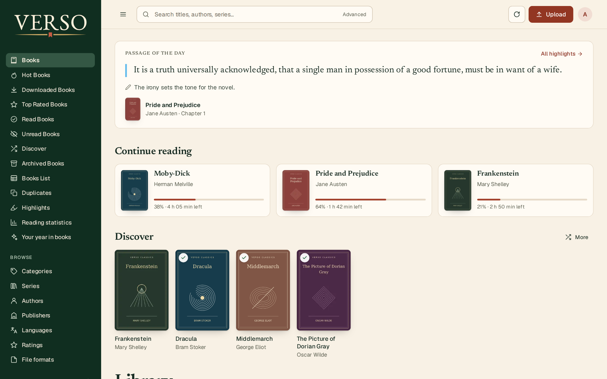
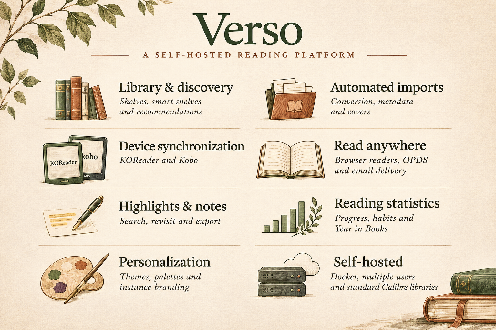

<h1 align="center">
  <picture>
    <source media="(prefers-color-scheme: dark)" srcset="cps/static/verso-wordmark-dark.svg">
    
  </picture>
</h1>

<p align="center">
  A self-hosted ebook library and reading platform.
</p>

<p align="center">
  <a href="#quick-start">Quick start</a> · <a href="#see-it-in-action">See it in action</a> · <a href="#features">Features</a> · <a href="#personalization">Personalization</a> · <a href="#documentation">Documentation</a>
</p>



---

## See it in action

https://github.com/user-attachments/assets/452935af-4322-41e1-8c60-38b1abe9a43c

<sub>Music: <a href="https://pixabay.com/music/modern-classical-keys-of-time-no-ai-335937/">Keys of Time (No AI)</a> by Good_B_Music, via Pixabay.</sub>

---

## Features



---

## Personalization


---

## Quick start

Requires Docker with the Compose plugin (amd64 or arm64).

```bash
git clone https://github.com/yo-less/verso.git verso
cd verso
docker compose up -d
```

Open **http://localhost:8083**.  
Create your administrator account.

Docker image: `ghcr.io/yo-less/verso:latest`

| Folder | Purpose |
| --- | --- |
| `./config` | Settings and user data |
| `./library` | Your Calibre library, new or existing |
| `./ingest` | Drop completed ebook files here; files are removed after import |

Back up your config and library before updating or migrating.  
Update with `docker compose pull && docker compose up -d`.

### Documentation

[All documentation](docs/README.md)  
[Installation](docs/installation.md) · [Configuration](docs/configuration.md) · [Migration](docs/installation.md#migrating-from-calibre-web-automated) · [Backups](docs/updating-and-backups.md)  
[KOReader](docs/koreader.md) · [Kobo](docs/kobo.md) · [Remote access](docs/remote-access.md) · [Issues](https://github.com/yo-less/verso/issues)
---

## Credits & license

Verso is a fork of [Scriptorium](https://github.com/MrColoo/scriptorium-library) by MrColoo and contributors.  
It builds on [Calibre-Web-Automated](https://github.com/crocodilestick/Calibre-Web-Automated), [Calibre-Web](https://github.com/janeczku/calibre-web) and [Calibre](https://calibre-ebook.com).  
Scriptorium introduced the redesigned interface, readers, personal styles, highlights and annual reading review.

This project uses AI for development and visual assets.  
Licensed under [GPL-3.0 or later](LICENSE), without warranty.  
See [NOTICE](NOTICE) and [CONTRIBUTORS](CONTRIBUTORS) for third-party credits.
