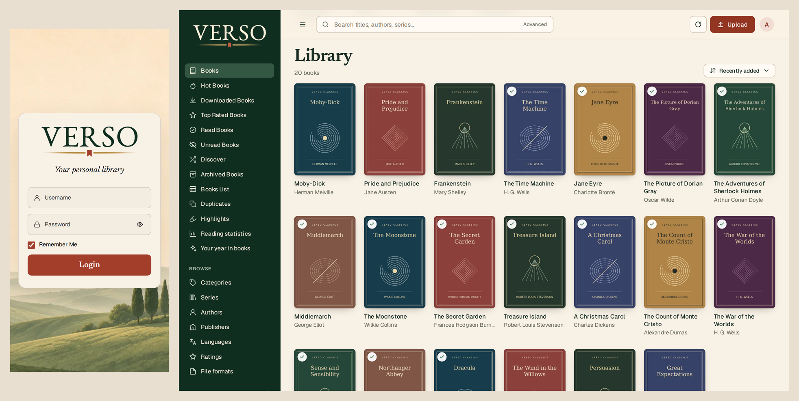
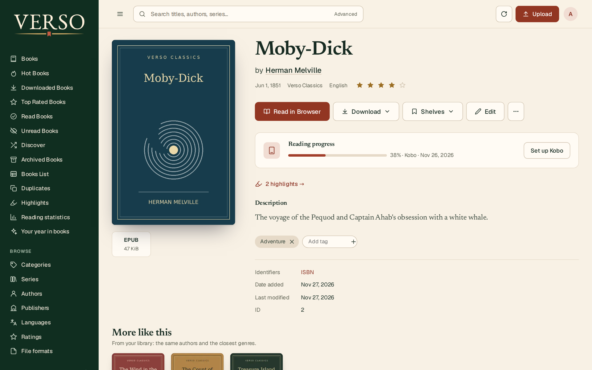
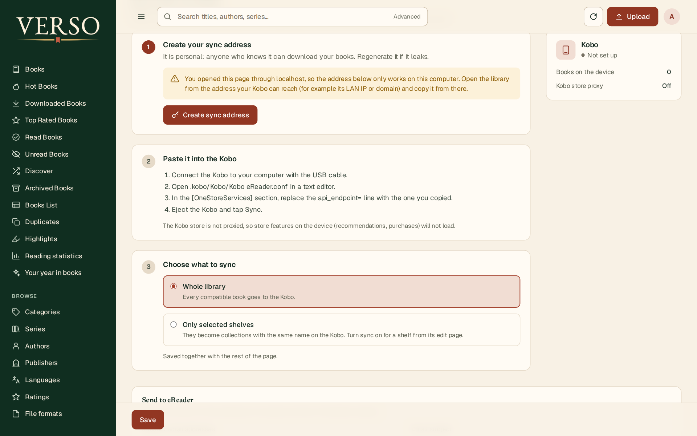
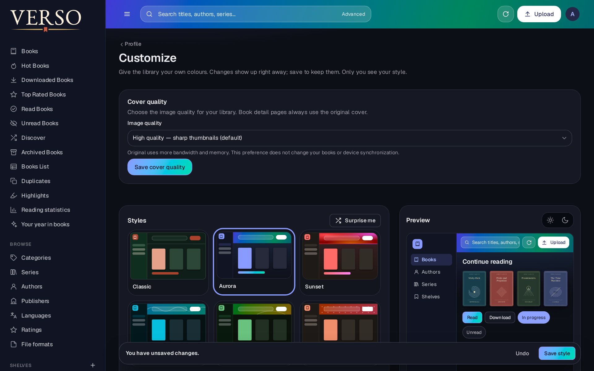
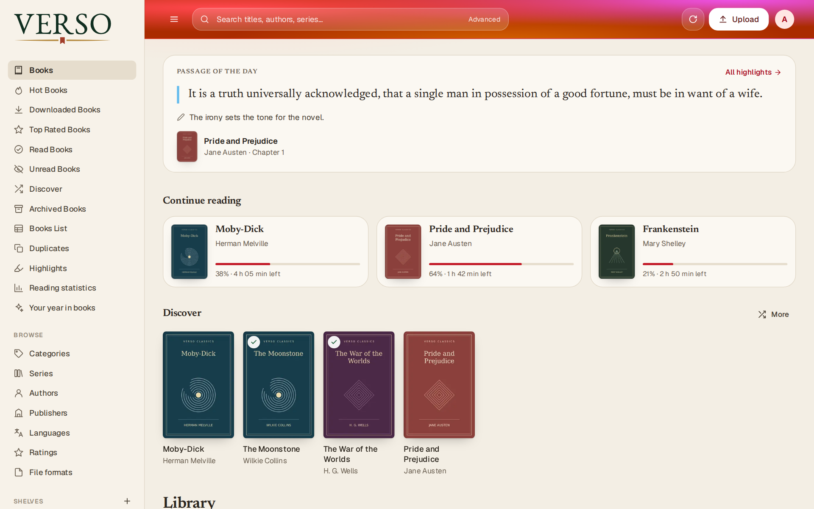
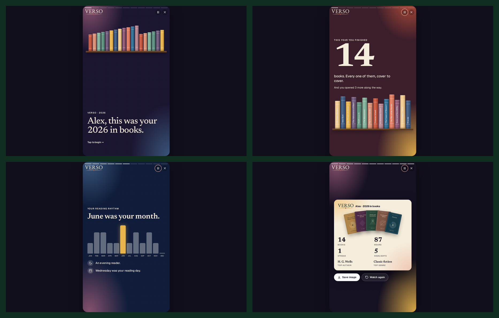
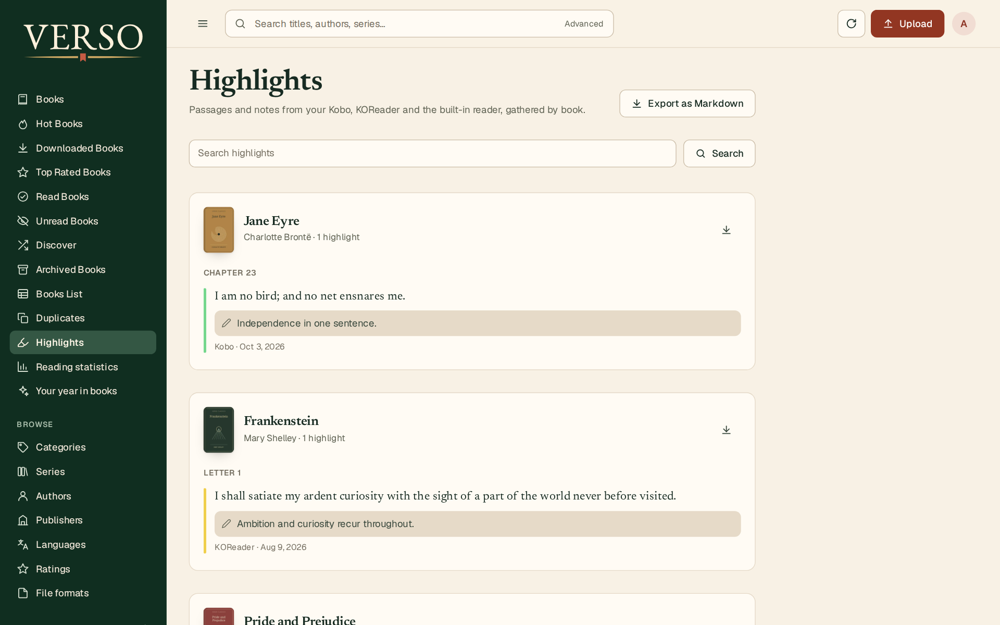
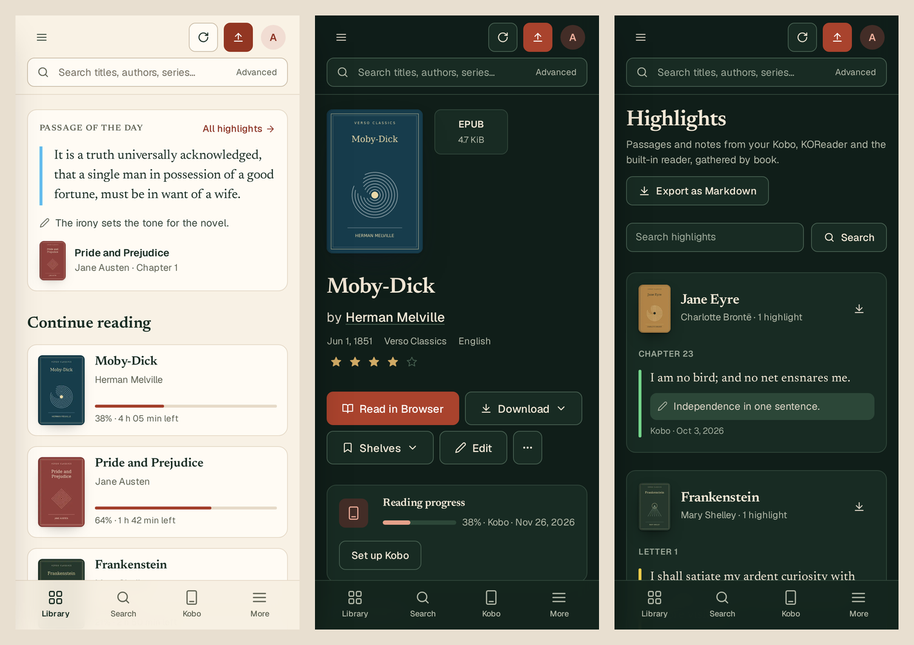

<h1 align="center">
  <picture>
    <source media="(prefers-color-scheme: dark)" srcset="cps/static/verso-wordmark-dark.svg">
    
  </picture>
</h1>

<p align="center">
  <strong>A self-hosted ebook library and reading platform.</strong><br>
  Standard Calibre libraries, automated imports and synchronized reading.
</p>

<p align="center">
  <a href="#quick-start"></a>
  
  <a href="docs/kobo.md"></a>
  <a href="LICENSE"></a>
</p>

<p align="center">
  <a href="#quick-start"><b>Quick start</b></a> ·
  <a href="#see-it-in-action">Demo</a> ·
  <a href="#features">Features</a> ·
  <a href="#screenshots">Screenshots</a> ·
  <a href="docs/README.md">Docs</a> ·
  <a href="#coming-from-calibre-web-automated">Migration</a>
</p>

<p align="center">
  
  <br><sub>Actual browser captures from a fictional Verso demonstration library.</sub>
</p>

---

## See it in action

https://github.com/user-attachments/assets/452935af-4322-41e1-8c60-38b1abe9a43c

[**Verso feature video (Download - High quality)**](https://github.com/yo-less/verso/releases/download/feature-video-v1/verso-features.mp4) · 1:13 · 1080p · with sound

<sub>Music: <a href="https://pixabay.com/music/modern-classical-keys-of-time-no-ai-335937/">Keys of Time (No AI)</a> by Good_B_Music, via Pixabay.</sub>

## Features

| Area | Capabilities |
| --- | --- |
| Library & automation | Watched-folder imports, conversion, metadata and covers, duplicate detection, EPUB repairs, original-file backups, smart shelves and related books. |
| Reading & devices | Kobo sync for books, shelves and progress; KOReader sync for progress, highlights and statistics; browser readers for ebooks, comics, PDF and text; OPDS and email delivery. |
| Reading history | Searchable highlights and notes with Markdown export, reading statistics, annual review and import from Goodreads or StoryGraph. |
| Personalization | Light and dark themes, personal styles, per-user cover quality and custom instance branding, including separate light/dark wordmarks. Responsive and installable interface. |
| Administration | Multiple users, permissions, per-user devices, LDAP, OAuth/OIDC, scheduled tasks, activity logs and translations. |

## Quick start

Requires Docker with the Compose plugin (amd64 or arm64).

```bash
git clone https://github.com/yo-less/verso.git verso
cd verso
docker compose up -d
```

Open **http://localhost:8083** and create your administrator account before sharing the address. Copy a finished ebook into `ingest` to import it. Files are removed from this folder after import.

[Beginner walkthrough](docs/start-here.md) · [Installation reference](docs/installation.md) · [Remote access](docs/remote-access.md)

| Host folder | Container path |
| --- | --- |
| `./config` | `/config` |
| `./ingest` | `/cwa-book-ingest` |
| `./library` | `/calibre-library` |

Mount your existing Calibre library at `/calibre-library`. Keep the three folders separate and back up both config and library. See [configuration](docs/configuration.md) for all environment variables.

## Screenshots

<p align="center">
  <picture>
    <source media="(prefers-color-scheme: dark)" srcset="docs/screenshots/library-dark.png">
    
  </picture>
  <br><sub><b>Home</b> — what you're reading on your Kobo, something to discover, and the whole library. It follows your light or dark theme.</sub>
</p>

<details>
<summary>More screenshots: book details, Kobo, themes, highlights and mobile</summary>

<table>
  <tr>
    <td width="50%">
      <picture>
        <source media="(prefers-color-scheme: dark)" srcset="docs/screenshots/book-dark.png">
        
      </picture>
      <p align="center"><sub><b>Book page</b> — read, download, send or shelve in one click</sub></p>
    </td>
    <td width="50%">
      <picture>
        <source media="(prefers-color-scheme: dark)" srcset="docs/screenshots/kobo-dark.png">
        
      </picture>
      <p align="center"><sub><b>Kobo setup</b> — one address to paste, guided step by step</sub></p>
    </td>
  </tr>
  <tr>
    <td width="50%">
      
      <p align="center"><sub><b>Customize</b> — ready-made styles with a live preview</sub></p>
    </td>
    <td width="50%">
      
      <p align="center"><sub><b>Sunset style</b> — each reader picks their own look</sub></p>
    </td>
  </tr>
</table>

<p align="center">
  
  <br><sub><b>Your year in books</b> — tap through your reading year, then save the poster</sub>
</p>

<p align="center">
  <picture>
    <source media="(prefers-color-scheme: dark)" srcset="docs/screenshots/highlights-dark.png">
    
  </picture>
  <br><sub><b>Highlights</b> — from your Kobo and KOReader, grouped by book and chapter</sub>
</p>

<p align="center">
  
  <br><sub><b>On your phone</b> — the same library, built for one hand</sub>
</p>

</details>

## Updates

Back up your config and library before updating.

```bash
docker compose pull && docker compose up -d
```

The image is published as `ghcr.io/yo-less/verso:latest` and with full commit SHA tags. See [Updating and backups](docs/updating-and-backups.md) for pinning and rollback.

## Coming from Calibre-Web-Automated

Verso uses the standard Calibre library and is based on Scriptorium and Calibre-Web-Automated v4.0.8.

1. Back up your config and library.
2. Change only the image in your Compose file to `ghcr.io/yo-less/verso:latest`. Keep your existing volumes, ports, environment variables and service name.
3. Run `docker compose pull && docker compose up -d`.

Newer CWA database changes have not been tested. Keep your backup for rollback. The existing Kobo and KOReader endpoints are retained; update the KOReader plugin when needed.

[Migration and existing libraries](docs/installation.md#migrating-from-calibre-web-automated) · [Migrating from Calibre-Web](docs/installation.md#migrating-from-calibre-web)

## Documentation

| Topic | Guides |
| --- | --- |
| Getting started | [Start here](docs/start-here.md), [First steps](docs/first-steps.md), [Using Verso](docs/using-scriptorium.md) |
| Devices | [Kobo](docs/kobo.md), [KOReader](docs/koreader.md), [Kindle, email and OPDS](docs/ereaders.md) |
| Server | [Installation](docs/installation.md), [Configuration](docs/configuration.md), [Remote access](docs/remote-access.md), [Backups](docs/updating-and-backups.md) |
| Administration | [Automation](docs/automation.md), [Administration](docs/administration.md), [Security](docs/security.md), [Troubleshooting](docs/troubleshooting.md) |
| Development | [Development](docs/development.md), [Publishing](docs/releasing.md), [Contributing](CONTRIBUTING.md) |

[All documentation](docs/README.md) · [Issues](https://github.com/yo-less/verso/issues) · [Report a security vulnerability](SECURITY.md)

## Credits & license

Verso is a fork of [Scriptorium](https://github.com/MrColoo/scriptorium-library) by MrColoo and contributors, which redesigned the interface and readers and added personal styles, highlights, the annual reading review and other reading features.

It builds on [Calibre-Web-Automated](https://github.com/crocodilestick/Calibre-Web-Automated), [Calibre-Web](https://github.com/janeczku/calibre-web) and [Calibre](https://calibre-ebook.com). Verso adds its own visual identity, configurable branding, cover-quality controls and original-cover API support, along with device-sync refinements.

This project uses AI for development and visual assets.

Licensed under [GPL-3.0 or later](LICENSE), without warranty. Original copyright notices remain intact. See [NOTICE](NOTICE) and [CONTRIBUTORS](CONTRIBUTORS) for third-party credits.
